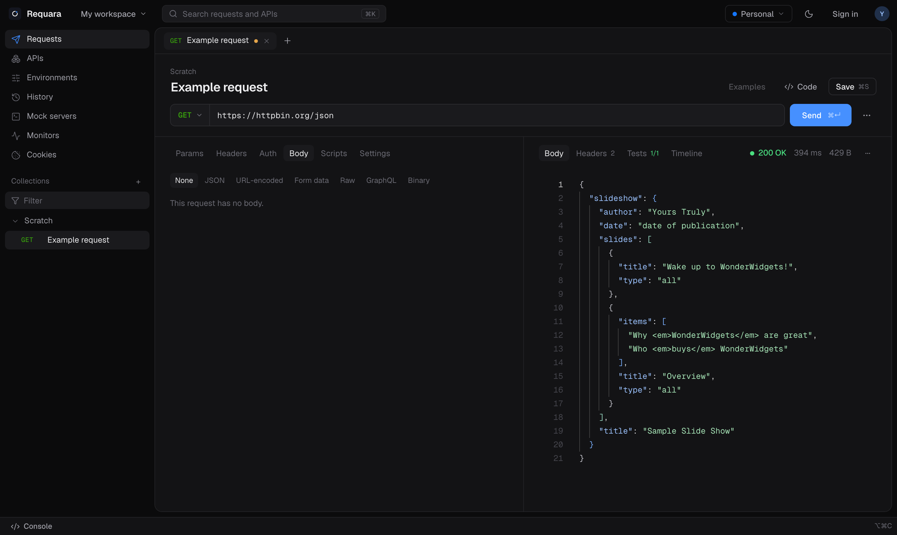

# Requara



Design, mock and test APIs with your team. Requara ships as two products from this repo:

| Product | What it is | Where it's released |
|---|---|---|
| **Server** | One Go program serving the API and the React web UI. Companies self-host it with Docker. | Docker image [`ghcr.io/anilcharles/requara`](https://github.com/anilcharles/requara/pkgs/container/requara), plus a Docker Compose bundle on each `server-vX.Y.Z` [release](https://github.com/anilcharles/requara/releases) |
| **Desktop** | A native GPUI app. Works on its own as a local API client; signing in to a team's server (Google, GitHub, Microsoft, company SSO, …) adds collaboration. | Installers for macOS, Windows and Linux on each `desktop-vX.Y.Z` [release](https://github.com/anilcharles/requara/releases) |

## Run the server

The server is one Docker image:

```sh
docker pull ghcr.io/anilcharles/requara:0.1.1   # or :latest
```

It needs Postgres, OpenBao (secrets) and S3 storage next to it. The Docker Compose
setup in [`server/deploy/docker-compose.yml`](server/deploy/docker-compose.yml) starts
all of them, wired together. Each server release attaches it as
`requara-selfhost-X.Y.Z.tar.gz`, with the version already pinned:

```sh
tar xzf requara-selfhost-0.1.1.tar.gz && cd requara
cp .env.example .env    # your URL, sign-in providers, admins
docker compose up -d
```

Configuration and sign-in setup: [`server/deploy/README.md`](server/deploy/README.md).
Kubernetes: [`server/deploy/kubernetes/requara.yaml`](server/deploy/kubernetes/requara.yaml).

## Layout

```
server/
  api/        Go backend (HTTP API, OIDC sign-in, request runner, mocks, jobs, and the web UI)
  web/        React + TypeScript web UI, built into the server image and served by Go
  deploy/     What customers run: docker-compose.yml, .env.example, OpenBao setup (bring your own OIDC provider)
  version.txt Server version (managed by release-please)
desktop/      GPUI desktop app (Rust)
branding/     Logo SVGs and icongen, which renders every app icon from them
docs/         README screenshot
dev/          Local development only: docker-compose for Postgres, Keycloak (local test IdP), S3, Mailpit, scripts
.github/      CI, PR-title check, releases
```

## Develop

```sh
./dev/scripts/dev-up.sh                        # Postgres, Keycloak, OpenBao (dev mode), S3, Mailpit
(cd server/api && go run ./cmd/requara)         # API on :8080
(cd server/web && npm install && npm run dev)  # web UI on http://localhost:5173
(cd desktop && cargo run)                      # desktop app; works locally, or sign in via http://localhost:5173
```

Sign in as `alex.chen` / `requara-dev`. Stop everything with `./dev/scripts/dev-down.sh`.

## Releases

[release-please](https://github.com/googleapis/release-please) reads commit messages (the PR title, since PRs are squash-merged) and keeps one release PR open per product:

- `fix: …` → patch, `feat: …` → minor, `feat!: …` → major (0.x: one level lower)
- Changes under `server/` release the server; changes under `desktop/` release the desktop app. Each only when its own files change.
- Merging a release PR tags it (`server-v0.3.0`, `desktop-v0.2.1`) and the release workflow builds and attaches what that product ships.

After the first server release, make the `server` GHCR package public (Package settings → Change visibility) so customers can pull it.

## The desktop app and the server

The desktop app checks `GET /api/version` before signing in. The server reports its `api` level; the app knows which levels it supports (`desktop/src/api.rs`, `SUPPORTED_API`). Raise `APIVersion` in `server/api/internal/api/version.go` only for changes older apps can't handle, and ship a desktop release that supports it first.
